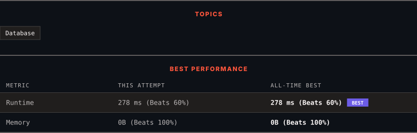

<div align="center">

# 620. Not Boring Movies

      

[](https://leetcode.com/problems/not-boring-movies/)

</div>

---

<div align="center">

<picture>
  <source media="(prefers-color-scheme: dark)" srcset="panel-dark.svg">
  <source media="(prefers-color-scheme: light)" srcset="panel-light.svg">
  
</picture>

</div>

> **New personal best** — Runtime improved on this submission.

### HOW IT WENT

| | |
|:--|:--|
| **Attempts** | 4 before accepted |
| **Time to solve** | 28 min |
| **Verdicts** | ❌ Wrong Answer → ❌ Wrong Answer → ❌ Wrong Answer → ✅ Accepted |

---

### NOTES

_No notes yet._

---

### SOLUTIONS (1)

| # | File | Language | Date |
|:-:|------|:--------:|:----:|
| 1 | [sol1.sql](./sol1.sql) | `MySQL` | 2026-10-13 ← **latest** |

---

### PROBLEM DESCRIPTION

Table: `Cinema`

```

+----------------+----------+
| Column Name    | Type     |
+----------------+----------+
| id             | int      |
| movie          | varchar  |
| description    | varchar  |
| rating         | float    |
+----------------+----------+
id is the primary key (column with unique values) for this table.
Each row contains information about the name of a movie, its genre, and its rating.
rating is a 2 decimal places float in the range [0, 10]

```

 

Write a solution to report the movies with an odd-numbered ID and a description that is not `"boring"`.

Return the result table ordered by `rating` **in descending order**.

The result format is in the following example.

 

**Example 1:**

```

**Input:** 
Cinema table:
+----+------------+-------------+--------+
| id | movie      | description | rating |
+----+------------+-------------+--------+
| 1  | War        | great 3D    | 8.9    |
| 2  | Science    | fiction     | 8.5    |
| 3  | irish      | boring      | 6.2    |
| 4  | Ice song   | Fantacy     | 8.6    |
| 5  | House card | Interesting | 9.1    |
+----+------------+-------------+--------+
**Output:** 
+----+------------+-------------+--------+
| id | movie      | description | rating |
+----+------------+-------------+--------+
| 5  | House card | Interesting | 9.1    |
| 1  | War        | great 3D    | 8.9    |
+----+------------+-------------+--------+
**Explanation:** 
We have three movies with odd-numbered IDs: 1, 3, and 5. The movie with ID = 3 is boring so we do not include it in the answer.

```

---

<div align="center">

<sub>Auto-synced by <strong>LeetSync</strong> · Built by <a href="https://deveshsamant.in/">Devesh Samant</a></sub>

</div>
