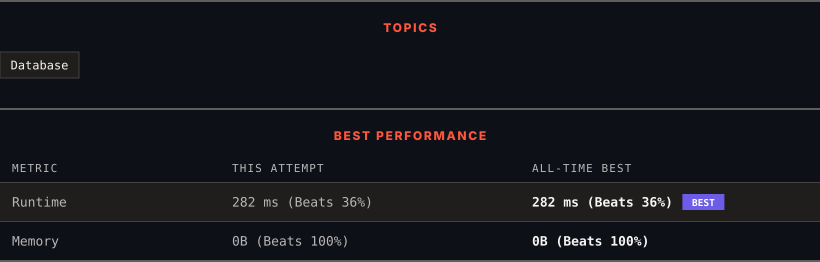

<div align="center">

# 627. Swap Sex of Employees

      

[](https://leetcode.com/problems/swap-sex-of-employees/)

</div>

---

<div align="center">

<picture>
  <source media="(prefers-color-scheme: dark)" srcset="panel-dark.svg">
  <source media="(prefers-color-scheme: light)" srcset="panel-light.svg">
  
</picture>

</div>

> **New personal best** — Runtime improved on this submission.

### HOW IT WENT

| | |
|:--|:--|
| **Attempts** | first try |
| **Time to solve** | under a minute |
| **Verdicts** | ✅ Accepted |

---

### NOTES

_No notes yet._

---

### SOLUTIONS (1)

| # | File | Language | Date |
|:-:|------|:--------:|:----:|
| 1 | [sol1.sql](./sol1.sql) | `MySQL` | 2026-10-19 ← **latest** |

---

### PROBLEM DESCRIPTION

Table: `Salary`

```

+-------------+----------+
| Column Name | Type     |
+-------------+----------+
| id          | int      |
| name        | varchar  |
| sex         | ENUM     |
| salary      | int      |
+-------------+----------+
id is the primary key (column with unique values) for this table.
The sex column is ENUM (category) value of type ('m', 'f').
The table contains information about an employee.

```

 

Write a solution to swap all `'f'` and `'m'` values (i.e., change all `'f'` values to `'m'` and vice versa) with a **single update statement** and no intermediate temporary tables.

Note that you must write a single update statement, **do not** write any select statement for this problem.

The result format is in the following example.

 

**Example 1:**

```

**Input:** 
Salary table:
+----+------+-----+--------+
| id | name | sex | salary |
+----+------+-----+--------+
| 1  | A    | m   | 2500   |
| 2  | B    | f   | 1500   |
| 3  | C    | m   | 5500   |
| 4  | D    | f   | 500    |
+----+------+-----+--------+
**Output:** 
+----+------+-----+--------+
| id | name | sex | salary |
+----+------+-----+--------+
| 1  | A    | f   | 2500   |
| 2  | B    | m   | 1500   |
| 3  | C    | f   | 5500   |
| 4  | D    | m   | 500    |
+----+------+-----+--------+
**Explanation:** 
(1, A) and (3, C) were changed from 'm' to 'f'.
(2, B) and (4, D) were changed from 'f' to 'm'.

```

---

<div align="center">

<sub>Auto-synced by <strong>LeetSync</strong> · Built by <a href="https://deveshsamant.in/">Devesh Samant</a></sub>

</div>
