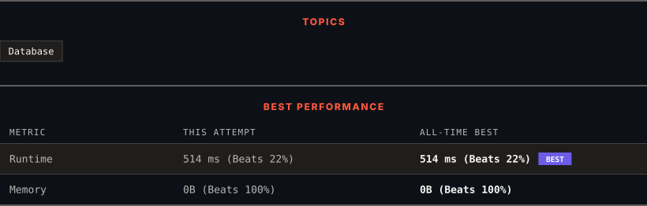

<div align="center">

# 1148. Article Views I

      

[](https://leetcode.com/problems/article-views-i/)

</div>

---

<div align="center">

<picture>
  <source media="(prefers-color-scheme: dark)" srcset="panel-dark.svg">
  <source media="(prefers-color-scheme: light)" srcset="panel-light.svg">
  
</picture>

</div>

> **New personal best** — Runtime improved on this submission.

### HOW IT WENT

| | |
|:--|:--|
| **Attempts** | first try |
| **Time to solve** | 1 min |
| **Verdicts** | ✅ Accepted |

---

### NOTES

_No notes yet._

---

### SOLUTIONS (1)

| # | File | Language | Date |
|:-:|------|:--------:|:----:|
| 1 | [sol1.sql](./sol1.sql) | `MySQL` | 2026-10-10 ← **latest** |

---

### PROBLEM DESCRIPTION

Table: `Views`

```

+---------------+---------+
| Column Name   | Type    |
+---------------+---------+
| article_id    | int     |
| author_id     | int     |
| viewer_id     | int     |
| view_date     | date    |
+---------------+---------+
There is no primary key (column with unique values) for this table, the table may have duplicate rows.
Each row of this table indicates that some viewer viewed an article (written by some author) on some date. 
Note that equal author_id and viewer_id indicate the same person.

```

 

Write a solution to find all the authors that viewed at least one of their own articles.

Return the result table sorted by `id` in ascending order.

The result format is in the following example.

 

**Example 1:**

```

**Input:** 
Views table:
+------------+-----------+-----------+------------+
| article_id | author_id | viewer_id | view_date  |
+------------+-----------+-----------+------------+
| 1          | 3         | 5         | 2019-08-01 |
| 1          | 3         | 6         | 2019-08-02 |
| 2          | 7         | 7         | 2019-08-01 |
| 2          | 7         | 6         | 2019-08-02 |
| 4          | 7         | 1         | 2019-07-22 |
| 3          | 4         | 4         | 2019-07-21 |
| 3          | 4         | 4         | 2019-07-21 |
+------------+-----------+-----------+------------+
**Output:** 
+------+
| id   |
+------+
| 4    |
| 7    |
+------+

```

---

<div align="center">

<sub>Auto-synced by <strong>LeetSync</strong> · Built by <a href="https://deveshsamant.in/">Devesh Samant</a></sub>

</div>
