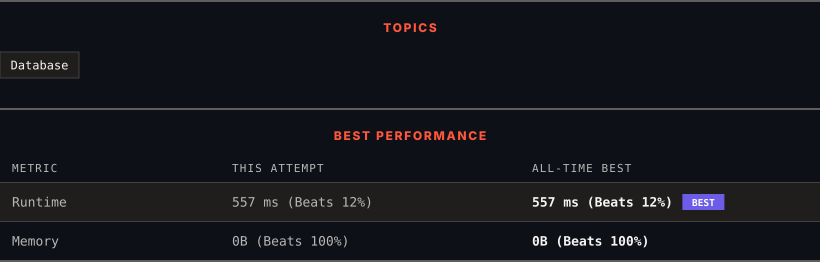

<div align="center">

# 1527. Patients With a Condition

      

[](https://leetcode.com/problems/patients-with-a-condition/)

</div>

---

<div align="center">

<picture>
  <source media="(prefers-color-scheme: dark)" srcset="panel-dark.svg">
  <source media="(prefers-color-scheme: light)" srcset="panel-light.svg">
  
</picture>

</div>

> **New personal best** — Runtime improved on this submission.

### HOW IT WENT

| | |
|:--|:--|
| **Attempts** | 6 before accepted |
| **Time to solve** | 8 min |
| **Verdicts** | ❌ Wrong Answer → ❌ Wrong Answer → ❌ Wrong Answer → ❌ Wrong Answer → ❌ Wrong Answer → ✅ Accepted |

---

### NOTES

_No notes yet._

---

### SOLUTIONS (1)

| # | File | Language | Date |
|:-:|------|:--------:|:----:|
| 1 | [sol1.sql](./sol1.sql) | `MySQL` | 2026-10-15 ← **latest** |

---

### PROBLEM DESCRIPTION

Table: `Patients`

```

+--------------+---------+
| Column Name  | Type    |
+--------------+---------+
| patient_id   | int     |
| patient_name | varchar |
| conditions   | varchar |
+--------------+---------+
patient_id is the primary key (column with unique values) for this table.
'conditions' contains 0 or more code separated by spaces. 
This table contains information of the patients in the hospital.

```

 

Write a solution to find the patient_id, patient_name, and conditions of the patients who have Type I Diabetes. Type I Diabetes always starts with `DIAB1` prefix.

Return the result table in **any order**.

The result format is in the following example.

 

**Example 1:**

```

**Input:** 
Patients table:
+------------+--------------+--------------+
| patient_id | patient_name | conditions   |
+------------+--------------+--------------+
| 1          | Daniel       | YFEV COUGH   |
| 2          | Alice        |              |
| 3          | Bob          | DIAB100 MYOP |
| 4          | George       | ACNE DIAB100 |
| 5          | Alain        | DIAB201      |
+------------+--------------+--------------+
**Output:** 
+------------+--------------+--------------+
| patient_id | patient_name | conditions   |
+------------+--------------+--------------+
| 3          | Bob          | DIAB100 MYOP |
| 4          | George       | ACNE DIAB100 | 
+------------+--------------+--------------+
**Explanation:** Bob and George both have a condition that starts with DIAB1.

```

---

<div align="center">

<sub>Auto-synced by <strong>LeetSync</strong> · Built by <a href="https://deveshsamant.in/">Devesh Samant</a></sub>

</div>
